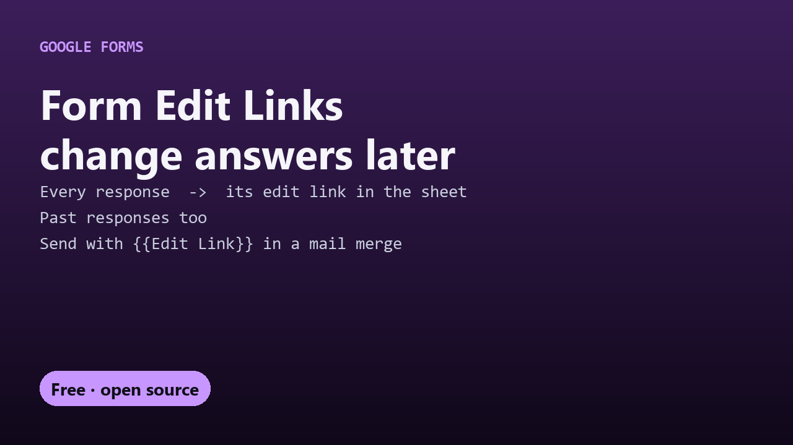

# Free Form Edit Links: edit any Google Form response later

Google Forms gives each response a private **edit link**, but only shows it once, to the respondent, right after they submit. This puts every response's edit link into a new **Edit Link** column of your response sheet, so you can fix a typo in someone's answer, or send people their link to update their own response.

- Fills links for all existing responses, then for each new one automatically
- One column, `Edit Link`, next to the answers; send it with any mail merge as `{{Edit Link}}`
- Never overwrites a link that's already there

New to this? Read the [step-by-step guide](https://decodedxr.github.io/form-edit-links/edit-google-form-responses.html).

## Setup (2 minutes)

1. Open the Google Sheet your form sends responses to (in the form: **Responses → Link to Sheets**).
2. **Extensions → Apps Script**. Replace `Code.gs` with this repo's `Code.gs` and click **Save**. Reload the sheet.
3. **✏️ Edit Links → Turn On**, and approve the permission prompt ("Google hasn't verified this app" → **Advanced → Go to (your project name) → Allow**; it's your own script).

For respondents to use their own links, also turn on **Settings → Responses → Allow response editing** in the form.

## Things to know

- Anyone with an edit link can change that response, so share each link only with its respondent.
- Responses are matched to rows by their timestamp. Two responses submitted within the same second could swap links; for very busy forms, add a hidden ID question or check the rare duplicate.
- When someone edits their response, the same sheet row updates and keeps its link.
- Turn Off stops new links; existing links keep working.

## More free Google tools

- [Form Prefill Links](https://github.com/DecodedXR/form-prefill-links): a pre-filled form link for every row of a sheet.
- [Form Auto-Reply](https://github.com/DecodedXR/form-auto-reply): a personalized email to everyone who submits.
- [All free Google Sheets scripts](https://github.com/DecodedXR/free-google-sheets-scripts).

## License

MIT. See `LICENSE`.
